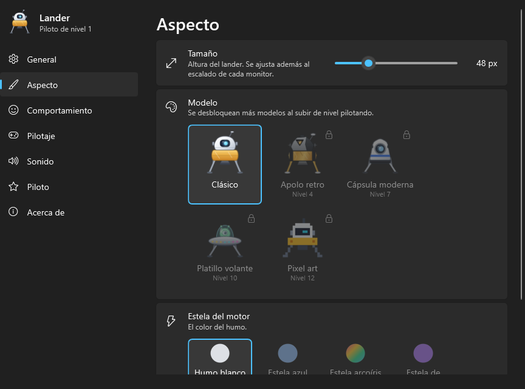

<p align="center">
  
</p>

<h1 align="center">Lander</h1>

<p align="center">
  Una mascota de escritorio para Windows 11: un pequeño módulo lunar que vive sobre tus ventanas<br/>
  y la barra de tareas, con física real de aterrizaje.
</p>

<p align="center">
  <a href="https://github.com/Kobayashi82/Lander/actions/workflows/ci.yml"></a>
  
  
</p>

---

**Tu escritorio es la superficie de un planeta y tus ventanas son las plataformas de aterrizaje.**

Por defecto, el lander vuela solo y tranquilo: descansa en la barra de tareas o sobre la barra de título
de una ventana y, cada pocos minutos, elige otro sitio y vuela hasta él. Pulsa **Ctrl+Alt+L** y tomas
el control: se convierte en un minijuego de *Lunar Lander* sobre tu propio escritorio.

## Características

**El mundo es tu escritorio**
- Las barras de título de las ventanas son plataformas; la barra de tareas es el suelo y la base, donde
  reposta y se repara. Las ventanas que tapan a otras tapan también su plataforma.
- Si mueves la ventana donde está posado, se mueve con ella; si la mueves muy deprisa, resbala, y si la
  agitas, se tambalea y puede volcar. Si la cierras o la minimizas, se cae… y se recompone en el aire.
- Varios monitores con distinto tamaño, posición y escalado: puede cruzar de uno a otro.
- Hacer *scroll* rápido cerca de él levanta una ráfaga de viento. Con el modo oscuro de Windows enciende
  sus luces de navegación.

**Modo automático con personalidad**
- Siete estados: reposar, elegir destino, volar, aterrizar, dormir, esquivar y volver a la base. Antes de
  despegar mira hacia el destino y muestra un bocadillo con una flecha.
- Energía, curiosidad y timidez: se cansa, investiga las ventanas nuevas y huye del cursor (o lo sigue,
  según lo tímido que lo configures).
- Reacciona a Windows: da un salto con las notificaciones, vuelve a la base a dormir si no usas el PC,
  va a recargar con la batería baja y celebra cuando vacías la papelera (vuela hasta su icono).

**Modo manual**
- Física honesta: gravedad, inercia, resistencia y combustible.
- Dos modos de pilotaje: **asistido** (las flechas desplazan sin girar) y **clásico** (giras y empujas,
  como el original).
- Aterrizajes perfectos, duros o accidentes; puntos según la dificultad de la plataforma, rachas,
  niveles de piloto, mejoras y aspectos desbloqueables.
- Misiones cortas: posarse sobre una aplicación concreta, recoger cristales, ida y vuelta sin repostar o
  llevar un paquete a otro monitor.

**Nunca estorba**
- El ratón atraviesa toda la capa del juego salvo el propio lander. No roba el foco ni aparece en
  Alt+Tab o en la barra de tareas.
- Con un vídeo, un juego o una presentación a pantalla completa se muda a otro monitor libre o se
  esconde. Con «No molestar», se queda quieto y en silencio.
- Muy ligero: en reposo consume en torno al **0,05 % de un núcleo** de CPU.
- Sonido desactivado por defecto; sonidos cortos y a volumen bajo.

<p align="center">
  
</p>

## Controles

| Tecla | Acción |
| --- | --- |
| **Ctrl+Alt+L** | Tomar o devolver el control (configurable) |
| ↑ | Motor principal |
| ← → | Propulsores laterales: girar (clásico) o desplazarse (asistido) |
| ↓ | Sacar las patas y estabilizar |
| Espacio | Impulso de emergencia (gasta mucho combustible) |
| Esc | Soltar el control |

Mientras pilotas, solo se capturan esas teclas: nunca escribes por accidente en otra ventana. Si pasan
30 segundos sin tocar nada, el lander vuelve a volar solo.

Con el ratón: **arrástralo** para cogerlo y lanzarlo, **haz clic** para hacerle una caricia, **doble
clic** para pilotarlo y **clic derecho** para abrir el menú. Un clic en el icono de la bandeja lo pone en
pausa.

## Instalación

Descarga la última versión desde [Releases](https://github.com/Kobayashi82/Lander/releases):

- `Lander-x.y.z-win-x64.zip`: ejecutable de 1,3 MB. Necesita el
  [.NET 10 Desktop Runtime](https://dotnet.microsoft.com/download/dotnet/10.0).
- `Lander-x.y.z-win-x64-standalone.zip`: no necesita instalar nada (≈65 MB).

Descomprime `Lander.exe` donde quieras y ejecútalo. El lander aparecerá en la barra de tareas y su
icono en el área de notificación. Para que arranque con Windows, actívalo en **Ajustes → General**.

Requisitos: Windows 10 u 11 (x64). Está pensado para Windows 11.

## Compilar desde el código

Necesitas el [SDK de .NET 10](https://dotnet.microsoft.com/download/dotnet/10.0).

```powershell
dotnet build                                   # compilar todo
dotnet test --project tests/Lander.Core.Tests  # tests del núcleo
dotnet run --project src/Lander.App            # ejecutar

# Publicar
dotnet publish src/Lander.App -p:PublishProfile=win-x64             # ejecutable pequeño
dotnet publish src/Lander.App -p:PublishProfile=win-x64-standalone  # autónomo
```

Los ejecutables quedan en `artifacts/publish/`. Al subir una etiqueta `v*` (por ejemplo `v0.1.0`),
GitHub Actions compila, prueba y publica una versión con ambos ejecutables.

### Opciones de línea de órdenes

| Opción | Para qué sirve |
| --- | --- |
| `--settings` | Abre los ajustes al arrancar. |
| `--exit` | Cierra limpiamente la instancia en marcha. |
| `--demo` | Modo demostración: simula a alguien delante del PC y vuela mucho más a menudo. |
| `--preview archivo.png` | Dibuja todos los aspectos, expresiones, bocadillos y el HUD en una imagen. |
| `--preview-hero archivo.png` | Genera la imagen de portada de este README. |
| `--preview-settings carpeta` | Guarda cada página de los ajustes como imagen, sin mostrarlos. |
| `--export-icon archivo.ico` | Regenera el icono del programa a partir del dibujo del lander. |

## Estructura

```
src/
  Lander.Core/    Simulación pura y testeable, sin dependencias de Windows:
                  terreno, física, piloto automático, misiones, progresión y ajustes.
  Lander.App/     Aplicación WPF: integración con Windows, motor, render, sonido,
                  bandeja del sistema y ventana de ajustes.
tests/
  Lander.Core.Tests/  Tests unitarios y simulaciones completas del piloto automático.
docs/
  diseno.md           Documento de diseño original.
  arquitectura.md     Decisiones técnicas y cómo encaja todo.
```

La arquitectura se explica en [docs/arquitectura.md](docs/arquitectura.md) y el diseño del juego en
[docs/diseno.md](docs/diseno.md).

## Datos y privacidad

Lander no se conecta a internet. Guarda los ajustes y el progreso en `%APPDATA%\Lander` y un registro
de los últimos siete días en `%LOCALAPPDATA%\Lander\logs`. Para leer el escritorio solo consulta la
posición de las ventanas y el nombre de su aplicación; nunca su contenido.

## Estado

Implementadas las fases 1 a 6 del diseño (prototipo, terreno real, modo manual, modo automático,
pulido y extras) y la publicación automática de ejecutables. Pendiente:

- Instalador firmado (MSIX) y publicación en Microsoft Store o itch.io.
- Varios landers a la vez y modo carrera con balizas y cronómetro.

## Licencia

Pendiente de definir.
