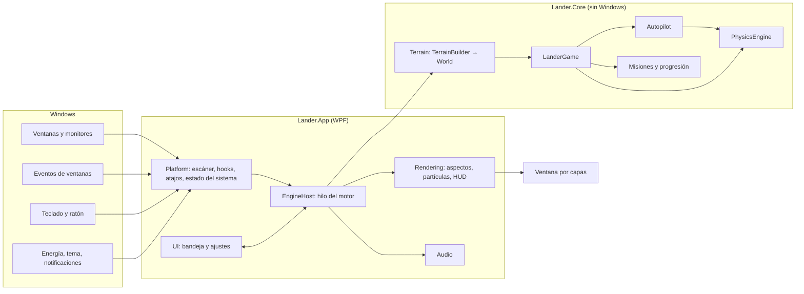
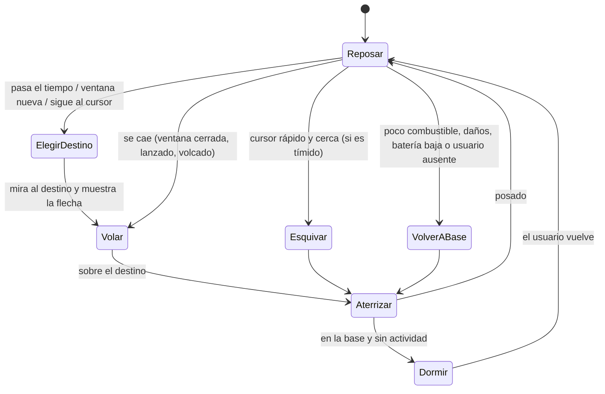
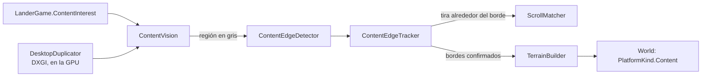

# Arquitectura de Lander

Este documento explica cómo está construido Lander y por qué. El diseño del juego está en
[diseno.md](diseno.md); aquí se cuenta cómo se ha llevado a código y en qué se ha desviado del plan
original.

## Visión general



La regla principal: **todo pasa por la física**. Tanto el jugador como el piloto automático solo
producen un `ThrustInput` (motor, giro, empuje lateral, estabilizador, impulso, patas). Nadie mueve el
lander directamente, así que los dos modos se comportan igual y el piloto automático no puede hacer
trampas.

## Proyectos

| Proyecto | Contenido |
| --- | --- |
| `Lander.Core` | Toda la lógica del juego, en C# puro y sin dependencias de Windows. Se puede probar entera con tests. |
| `Lander.App` | El ejecutable WPF (`Lander.exe`): integración con Windows, motor, render, audio e interfaz. |
| `Lander.Core.Tests` | Tests de xUnit v3 sobre Microsoft.Testing.Platform, incluidas simulaciones de diez minutos de vida autónoma. |

### Lander.Core

- **Terrain**. `TerrainBuilder` convierte monitores y ventanas (en orden Z, de arriba abajo) en un
  `World` inmutable: plataformas de un solo sentido (solo se aterriza desde arriba) y límites (techos,
  suelos de seguridad y paredes con huecos donde hay otro monitor al lado). Recorta las esquinas
  redondeadas de Windows 11 y resta las partes de la barra de título tapadas por ventanas de encima. Las
  ventanas maximizadas, o pegadas arriba sin sitio para el lander, no ofrecen plataforma (su barra de
  título es el techo de la pantalla), aunque siguen tapando lo que tengan detrás.
- **Physics**. Paso fijo de 60 Hz con integración de Euler semiimplícita. Las magnitudes están definidas
  para un lander de 48 px a 100 % de escala y se multiplican por la escala real (tamaño elegido × DPI
  del monitor), así que la sensación es la misma en cualquier pantalla. Posado sobre una ventana, la
  velocidad de la plataforma se estima a partir de las marcas de tiempo de cada `World` (no de los pasos
  de física), lo que hace la estimación independiente de la frecuencia de escaneo. Con eso se modela el
  agarre de las patas (sigue a la ventana o resbala), el balanceo (terremoto y vuelco) y la separación
  (la ventana cae más deprisa que la gravedad o frena en seco al subir). Los saltos de más de 250 px
  (maximizar, restaurar) se tratan como teletransportes: el lander se queda donde estaba y cae.
- **Autopilot** (`Autopilot.cs` y sus partes `.Flight`, `.Maneuvers`, `.Ballistic`, `.Landing` y
  `.Behaviors`). Máquina de estados con los siete estados del diseño. El vuelo usa un controlador en
  cascada: posición → velocidad deseada (perfiles de frenado que cuentan con lo que tarda en girar) →
  aceleración → inclinación y motor, exactamente lo que haría un piloto. Cada vuelo elige un estilo según
  distancia, desnivel, energía, combustible, lo que haya por el camino y el ajuste de acrobacias:
  - crucero, rasante, perezoso (bajada en hoja) y arco (curva de Bézier seguida con una «zanahoria»);
  - **siguiendo el relieve**: la altura objetivo sale de la plataforma más alta que tiene delante (mira
    más lejos cuanto más deprisa va) y nunca pasa del techo de lo que va a recorrer;
  - **ondulante**: una onda sobre la altura de crucero, con la pendiente anticipada con la velocidad lateral
    y aplanada cerca del suelo, del techo y del destino;
  - **de precisión**: `FlightGuidance.TrackVelocityLevel` sostiene con el motor principal y se desplaza
    con los propulsores de traslación, sin inclinarse (también en la aproximación);
  - **salto balístico**: `FlightPredictor.LaunchVelocity` calcula, disparando unas cuantas parábolas con
    la resistencia del aire, la velocidad que lleva hasta una cima bajo el techo y pasa por un punto sobre
    el destino. Empuja hasta tenerla, apaga el motor y, cada 50 ms, simula «¿y si frenara ya?» con las
    mismas ecuaciones que la física: enciende en el último instante en que la frenada aún termina sobre el
    destino. Si la parábola real se sale de los monitores, cambia a crucero o frena antes;
  - **picado**: crucero hasta que el destino queda a unos 40° por debajo y el tramo recto está despejado;
    entonces baja en diagonal y se encabrita (hasta 0,95 rad) cuando la misma simulación dice que es el
    momento;
  - **frenada final**: sube sobre el destino, apaga el motor, cae y enciende cuando la deceleración
    necesaria llega al 78 % de la disponible, con el empuje justo para tocar a 32 px/s;
  - **a saltitos** cuando el destino está en la misma plataforma: varios saltos de tres o cuatro alturas,
    posándose (y agachándose) entre uno y otro.

  Puede intercalar una voltereta si hay sitio (o darla en plena parábola), hacer un reconocimiento
  mirando a un lado y otro antes de posarse en un sitio nuevo, salir disparado con el impulso al esquivar
  el cursor y saludarlo al pasar volando a su lado. Con el ajuste de acrobacias a «Ninguna» no hay
  volteretas, caídas libres, saltos balísticos ni vuelos ondulantes.
- **FlightEnvelope**: nunca contra el techo ni las paredes. Recorta la velocidad deseada para poder
  frenar siempre (hacia arriba basta con apagar el motor; de lado cuenta con lo que tarda en inclinarse
  hacia el otro lado, y los propulsores de traslación ayudan) y, como última comprobación, apaga el motor
  si el punto más alto que alcanzaría por inercia quedara pegado al borde superior; ese borde es el del
  tramo que va a barrer de lado, así que junto a un monitor más bajo cuenta su techo antes de llegar.
  `PathIsClear` comprueba que un recorrido (arco, parábola, picado) quede con todo el cuerpo dentro de
  los monitores, bajo el techo y sin rozar un suelo más alto que el destino.
- **FuelPlanner**: estima el combustible de un vuelo (prudente en la mayoría de casos). No sale a un
  sitio desde el que no pueda volver a la base, vuelve a repostar a tiempo y, en vuelo, se desvía a la
  base o aterriza donde pueda (con frenada final, que es lo más económico) antes de quedarse seco. Sin
  combustible no hay motor: cae como cualquier otra cosa.
- **Despistes** (opcionales): por vuelo hay una probabilidad de calcular mal la altura o la frenada,
  pasarse de largo o tocar torcido. Casi siempre acaba en un aterrizaje duro; los más graves, en
  accidente. No cuentan en las estadísticas del jugador.
- **Missions** y **Progression**: misiones, puntuación, niveles, desbloqueos y mejoras. Un aterrizaje
  solo puntúa tras un vuelo de verdad (al menos 1,5 s y, si vuelve a la misma plataforma, habiendo
  subido), para que no se puedan granjear puntos tocando y despegando.
- **Racing**: el modo carrera. `RaceSystem` traza un circuito de hasta cuatro ventanas (elegidas al azar,
  con más probabilidad cuanto más lejos de la anterior, y solo si son anchas y tienen sitio por encima) que
  termina en la base. El cronómetro arranca al despegar; cada baliza rellena el depósito, un aterrizaje
  brusco suma 2 s y un accidente o volver al automático la pierden. El tiempo de referencia (medalla de
  oro) sale de la longitud de cada tramo, con un ritmo distinto al subir, bajar y desplazarse, más un
  margen fijo por aterrizaje. Los récords son por circuito (la secuencia de ventanas) y duran la sesión,
  porque los identificadores de ventana no sobreviven a un reinicio. Mientras dura una carrera no hay
  misiones.
- **Achievements**: logros calculados a partir de las estadísticas, sin estado propio; el juego solo
  recuerda cuáles ha anunciado ya en esta sesión.
- **DemoPilot**: piloto simulado que pulsa las teclas del modo manual. Lo usan `--demo-manual`,
  `--demo-race` y los tests de la carrera.
- **Settings**: modelo de ajustes y almacenamiento JSON con escritura atómica (archivo temporal y
  reemplazo) y serialización generada en compilación.
- **Vision**: bordes del contenido de las ventanas (opción experimental, ver «Contenido de las ventanas»):
  detector, seguimiento entre escaneos, medida del scroll y reglas de privacidad. Recibe píxeles en escala
  de grises; no sabe nada de Windows.



### Lander.App

```
Engine/      EngineHost: bucle del motor, sucesos de Windows, efectos y sonidos.
Platform/    Monitores, escáner de ventanas, hooks de eventos, atajos, papelera, escritorios
             virtuales, estado del sistema e inicio con Windows.
Rendering/   Ventana por capas, aspectos (Skins/), partículas, bocadillos, HUD y marcadores.
Vision/      Duplicación del escritorio y qué contenido mirar en cada momento (opción experimental).
Audio/       Sonidos sintetizados y mezclador sobre waveOut.
UI/          Icono de bandeja, menú, ventana de ajustes (Fluent) y herramientas de vista previa.
Services/    Ajustes, registro, instancia única y rutas.
Interop/     Declaraciones Win32 con LibraryImport (P/Invoke generado en compilación).
```

## Hilos

| Hilo | Qué hace |
| --- | --- |
| Interfaz (WPF) | Icono de la bandeja, menú, ventana de ajustes y guardado de ajustes y progreso. |
| Motor (STA) | Crea y posee la ventana del lander, los hooks, los atajos y el temporizador; escanea el escritorio, simula, dibuja y decide los sonidos. |
| Audio | Solo existe con el sonido activado: mezcla las voces y alimenta waveOut. |
| Vsync | Solo mientras algo se mueve: espera al reloj del compositor y despierta al motor en cada refresco. |

La interfaz manda órdenes al motor con `EngineHost.Post` (cola concurrente más un evento que lo
despierta) y el motor avisa a la interfaz con `Dispatcher.BeginInvoke`. El progreso viaja como copias
independientes (`PilotProgress.Clone`), nunca compartido.

El bucle del motor espera con `MsgWaitForMultipleObjectsEx` sobre un temporizador de alta resolución y el
evento de órdenes, de modo que atiende mensajes de Windows al instante y no gasta nada entre ciclos. Su
ritmo se adapta:

| Situación | Ciclos por segundo |
| --- | --- |
| Volando, pilotando, partículas, animaciones o una ventana moviéndose | El refresco del monitor (máx. 165; 30 con ahorro de energía) |
| Cursor cerca o bocadillo visible | 20 |
| Posado y tranquilo | 4 |
| Posado y el usuario lleva más de un minuto sin tocar nada | 2 |

Solo se redibuja cuando cambia algo visible (se compara una firma del estado del fotograma).

## Render por GPU

El lander se dibuja con **Direct2D sobre Direct3D 11** (en la GPU; si no hay, con WARP) y se muestra con
**DirectComposition** (paquetes Vortice):

- Hay una ventana por monitor, transparente al ratón, sin mapa de bits de redirección
  (`WS_EX_NOREDIRECTIONBITMAP`): vacía no ocupa memoria ni le cuesta nada a DWM. Mide un píxel menos que
  el monitor por arriba para que ninguna heurística de Windows la tome por una aplicación a pantalla
  completa, y se oculta en los monitores que sí tienen una.
- Todas muestran la misma superficie de DirectComposition, desplazada a donde está el lander. La imagen y
  su posición cambian en la misma transacción (`Commit`): el movimiento nunca tiembla y cruzar de un
  monitor a otro es continuo.
- El arte se sigue escribiendo con la API de dibujo de WPF: cada fotograma se graba en un
  `DrawingGroup` y `DrawingReplayer` lo reproduce con Direct2D (geometrías, degradados, recortes,
  opacidades, texto e iconos). Las piezas fijas se convierten una sola vez; los pinceles nunca se
  modifican tras usarlos (Direct2D vaciaría su lote de dibujo) y los halos se dibujan en un espacio
  unitario para compartir el mismo pincel.
- Ritmo: un hilo espera al reloj del compositor (`DCompositionWaitForCompositorClock` en Windows 11; si
  no, la sincronía vertical de la salida de vídeo o `DwmFlush`) y despierta al motor justo después de
  cada refresco. Así las animaciones van a 60, 144 Hz o lo que dé el monitor (con un tope de 165), y la
  física, a 60 Hz fijos, se interpola entre pasos (también posado sobre una ventana que se mueve).
- Clics: como la capa de dibujo deja pasar siempre el ratón, la ventana por capas de siempre hace de
  diana invisible (alfa 1/255) con la forma del cuerpo del lander, y solo aparece cuando el cursor se
  acerca.
- Si la GPU se pierde (controlador actualizado, sesión remota), se recrea todo; tras tres fallos, o con
  `--software`, se dibuja por CPU como antes: `RenderTargetBitmap` → sección DIB →
  `UpdateLayeredWindow`.

Un fotograma típico cuesta unos 0,8 ms de CPU en total (grabar 0,2 ms, Direct2D 0,2 ms, envío al
compositor 0,4 ms) con el rasterizado en la GPU. En reposo solo se redibuja cuando cambia algo visible, y
el motor se despierta justo cuando el lander parpadea.

Las partículas viven en coordenadas del mundo y se desvanecen al acercarse al borde del fotograma para
que no se note el recorte. Los marcadores de misión (cristales, balizas) usan sus propias ventanitas
transparentes.

Los cinco aspectos son vectoriales y se dibujan en «unidades base» (48 de alto, origen en el centro de
masas); la ventanilla de la cabina hace de ojo y cambia con la expresión. El icono del programa y el de la
bandeja se generan con el mismo código.

## Leer el escritorio

- `WindowScanner` recorre las ventanas con `EnumWindows` (orden Z) y se queda con las visibles, no
  minimizadas, no «cloaked» (así se descartan las de otros escritorios virtuales y las aplicaciones
  suspendidas) y que no son piezas del shell. Usa los límites de DWM
  (`DWMWA_EXTENDED_FRAME_BOUNDS`), sin sombras ni bordes invisibles. Las ventanas de aplicaciones con
  permisos de administrador también se leen sin problema.
- La barra de tareas se deduce del **área de trabajo** de cada monitor: funciona igual centrada o a la
  izquierda, en cualquier borde, con ocultación automática (el suelo pasa a ser el borde inferior) y en
  monitores secundarios. Por eso no hace falta `SHAppBarMessage`.
- `SetWinEventHook` (fuera de proceso, sin inyectar nada) avisa de ventanas que aparecen, se mueven, se
  minimizan o se cierran. Muchas aplicaciones (widgets de Rainmeter, superposiciones) emiten eventos de
  movimiento continuamente sin moverse: solo cuentan los de ventanas que forman terreno y cuyo rectángulo
  ha cambiado de verdad. Además hay un escaneo de seguridad cada dos segundos.
- Mientras se arrastra una ventana se reescanea a 60 Hz; el resto del tiempo, solo cuando algo cambia.

## Contenido de las ventanas (experimental)

Con la opción **Posarse en el contenido** el lander también aterriza en bordes horizontales claros dentro
de las ventanas y los sigue cuando se hace scroll. Está desactivada por defecto.



**Cuándo se mira.** `LanderGame.ContentInterest` dice qué hace falta: nada (casi siempre), los segundos
previos a elegir destino (`ChoosingSoon`, 1,6 s: da para dos escaneos), el borde hacia el que vuela o
sobre el que está posado, y las ventanas de alrededor mientras se pilota a mano. `ContentVision` traduce
eso en ventanas concretas del monitor del lander (primero la activa), como mucho dos escaneos por segundo
por ventana, y deja de capturar unos segundos después de que deje de hacer falta.

**Captura.** `DesktopDuplicator` usa la duplicación del escritorio de DXGI sobre el mismo `ID3D11Device`
que el render si está en el mismo adaptador (si no, o con `--software`, crea uno). Ve exactamente lo que
ve el usuario, sin aviso amarillo y con el contenido protegido en negro. Cada fotograma nuevo
(`AcquireNextFrame` sin espera) se copia en la GPU a una textura propia, de modo que cualquier región se
puede leer más tarde aunque la pantalla no cambie; se guardan también los rectángulos modificados. Leer es
asíncrono: en un ciclo se encola la copia de la región a una textura de lectura y en el siguiente se mapea
con `DoNotWait`, así que el motor nunca espera a la GPU. Si los rectángulos modificados dicen que la
región no ha cambiado desde el escaneo anterior, no se lee nada: cuenta como haber visto lo mismo. Las
ventanas del lander se excluyen de cualquier captura (`WDA_EXCLUDEFROMCAPTURE`) mientras la opción está
activa; si Windows no lo admite, o con `--show-in-captures`, se pasa al detector la zona del lander como
«desconocida».

**Detección.** `ContentEdgeDetector` recorre la imagen una vez. Por cada fila calcula con `Vector128`,
de 16 en 16 píxeles, tres máscaras de bits: salto fuerte de brillo respecto a la fila de encima (24 de
255 o más; hacia más claro y hacia más oscuro por separado) y «ocupado» (cualquier variación de 10 o más
con la fila de encima o con el vecino). Un candidato es un tramo de al menos tres anchos del lander en una
de las dos primeras, con huecos de 2 px como mucho; vale la parte cuyas filas de encima, en la altura del
lander, no tienen nada ocupado (se guardan en un búfer circular de máscaras). Así el texto no da bordes
(entre letra y letra hay fondo, y encima de un renglón hay otro) ni los separadores de una tabla con texto
encima, y una línea fina solo da su cara de arriba. Se afinó con capturas reales de Wikipedia, GitHub, MDN,
BBC, VS Code y un vídeo; los tests reproducen esos casos con imágenes sintéticas.

**Seguimiento.** `ContentEdgeTracker` guarda de cada borde una franja de píxeles (6 filas por encima y 18
por debajo, hasta 160 columnas). Un borde se confirma cuando aparece en dos escaneos seguidos con la parte
alta de su franja igual (diferencia media de 6 o menos): lo que se repinta (vídeo, animaciones) no se
confirma, y un texto que cambia debajo no le hace perder la identidad. Si un borde ya no está en su sitio,
se busca entre los nuevos uno cuya franja entera encaje desplazada (la página se ha movido entre dos
escaneos) y conserva su identificador. Los bordes se guardan relativos a su ventana; el terreno los
convierte en `PlatformKind.Content` con un identificador que combina ventana y borde, con las mismas reglas
de oclusión que las barras de título (comprobando toda la altura libre de encima), y también en ventanas
maximizadas.

**Scroll.** Posado sobre un borde, cada vez que los rectángulos modificados tocan su franja (o gira la rueda
sobre esa ventana, que llega por raw input y despierta al motor) se lee una tira alrededor con ±160 DIP de
margen y `ScrollMatcher` busca el desplazamiento: todas las posiciones con una de cada ocho columnas y una
de cada dos filas, y luego afina las cuatro mejores con todo, con una ligera preferencia por el
desplazamiento anterior (en una tabla de filas iguales, varias posiciones encajan igual). El borde se
mueve y, provisionalmente, el resto de la página con él hasta el siguiente escaneo. Mientras dura el
scroll se mide a cada fotograma y no se hacen escaneos completos. Si no encaja en ningún sitio (ha salido
de la vista o la página ha cambiado), el borde desaparece y el lander se cae y se recupera como cuando se
cierra una ventana. La física sigue a la plataforma como a una ventana que se mueve: si la página sube, lo
lleva; si baja más deprisa que la gravedad, se separa.

**Comportamiento.** El piloto automático elige bordes de contenido de vez en cuando: cada ventana reparte
su peso entre sus bordes (crece con la raíz de cuántos tiene) y los de la ventana activa valen casi el
doble. En manual son plataformas normales y puntúan como mínimo como una ventana estrecha (×3).

**Privacidad.** `ContentPrivacy` excluye por nombre de proceso los gestores de contraseñas, autenticadores
y pantallas de credenciales de Windows, y por título las ventanas de banca, pagos, contraseñas, inicios de
sesión y navegación privada, además de las aplicaciones que añada el usuario. Una ventana sin proceso
conocido tampoco se mira. Las imágenes viven en un búfer en memoria que se reutiliza: nunca se guardan ni
se envían.

## Integración con Windows

| Función | Cómo |
| --- | --- |
| Atajo global | `RegisterHotKey`; en modo manual se registran también flechas, Espacio y Esc (no se usa un hook de teclado). El estado de las teclas se lee con `GetAsyncKeyState`. |
| Pantalla completa | `SHQueryUserNotificationState` y la ventana en primer plano: si ocupa el monitor del lander, este se muda a otro monitor libre; si no hay ninguno (o es un juego exclusivo o una presentación), aterriza y se esconde. |
| No molestar | `SHQueryUserNotificationState` (horas tranquilas, presentación) y las notificaciones desactivadas en el registro. |
| Inactividad | `GetLastInputInfo`. |
| Batería y ahorro de energía | `GetSystemPowerStatus` y `WM_POWERBROADCAST`. |
| Modo oscuro | Registro (`AppsUseLightTheme`), releído con `WM_SETTINGCHANGE`. |
| Notificaciones | Ventanas del shell `Windows.UI.Core.CoreWindow` cuyo título contiene «notificación». |
| Papelera | `SHChangeNotifyRegister` sobre la papelera y `SHQueryRecycleBin`; la posición del icono se pide a la vista del escritorio (`IShellWindows` → `IShellBrowser` → `IFolderView`). |
| Escritorios virtuales | `IVirtualDesktopManager` mueve las ventanas del lander al escritorio activo. |
| Viento | Raw input del ratón (solo mientras el cursor está cerca del lander) para notar la rueda. |
| Contenido de las ventanas | Duplicación del escritorio de DXGI (`IDXGIOutput5::DuplicateOutput1`) y `SetWindowDisplayAffinity(WDA_EXCLUDEFROMCAPTURE)` en las ventanas propias; raw input de la rueda también mientras está posado en el contenido de una ventana. |
| Inicio con Windows | Clave `Run` del usuario. |
| DPI | Manifiesto *Per-Monitor V2*: todo el motor trabaja en píxeles físicos. |

## Interfaz

WPF con el tema Fluent de .NET (`ThemeMode = System`), que sigue el modo claro u oscuro de Windows y usa
los colores de Windows 11. Los ajustes reproducen la Configuración de Windows 11 (navegación con
pastilla de acento, tarjetas con icono, interruptores). El icono de la bandeja usa `Shell_NotifyIcon`
directamente (sin WinForms) y se vuelve a añadir si el Explorador se reinicia.

## Rendimiento medido

En un equipo de 16 núcleos con dos monitores (3440×1440 y 1920×1080):

| Situación | CPU |
| --- | --- |
| Posado, usuario ausente | ~0,05 % de un núcleo |
| Dibujo de un fotograma | 0,8 ms |
| Escaneo del escritorio | 0,15 ms |
| Contenido: escaneo de una ventana de 1200×800 (gris + bordes + seguimiento) | 0,3 + 0,3 ms |
| Contenido: monitor entero de 3440×1440 | 1,6 + 1,4 ms |
| Contenido: medir el scroll de un borde de 800 px (±160 px) | 0,4 ms |

Con `--demo` y una compilación Debug, el motor registra cada diez segundos sus ciclos, dibujos,
escaneos y eventos por segundo.

## Pruebas

- Tests unitarios de geometría, terreno, física, aterrizajes, puntuación, niveles, misiones y ajustes.
- Simulaciones completas: el piloto automático vuela a ventanas y aterriza perfecto con varias semillas;
  diez minutos de vida autónoma sin un solo accidente; recuperación al desaparecer la ventana; vuelta a
  la base con poco combustible; dormir y despertar; esquivar el cursor; salto con notificaciones; viaje a
  la papelera; lanzarlo con el ratón.
- Modo carrera: reglas de balizas, penalizaciones, récords y medallas, y una carrera completa con el
  piloto simulado, que debe terminar con plata (es prudente) para comprobar que el tiempo de referencia
  es exigente pero alcanzable.
- Técnicas de vuelo una a una (forzando el estilo): todas aterrizan perfecto; el salto balístico vuela con
  el motor apagado y frena al final; el vuelo de precisión no se inclina; los saltitos se posan entre
  salto y salto; sin acrobacias no hay volteretas ni caídas libres; entre dos monitores de distinta altura
  no roza paredes. También que `FlightPredictor` sigue exactamente la física y que la parábola calculada
  pasa por donde debe.
- Durante el desarrollo se usó además una prueba de estrés: 400 escritorios aleatorios de uno o dos
  monitores (de 1366×768 a 4K, desplazados en vertical hasta 400 px, con ventanas que se salen de la
  pantalla), distinto DPI y tamaño de lander, quince minutos cada uno. Con los despistes desactivados:
  unos 9600 aterrizajes sin un accidente, sin tocar el techo ni quedarse sin combustible, y una docena de
  roces suaves con una pared (antes de esta revisión: 3 accidentes, 3 depósitos vacíos y más de 200 roces
  en 4300 aterrizajes). Cada técnica nueva se probó además forzada en 300 escritorios.
- `--preview` y `--preview-settings` permiten revisar todo el arte y la interfaz sin volar.
- Contenido de las ventanas: detector sobre imágenes sintéticas que reproducen capturas reales (títulos
  subrayados, tablas, fotos, texto, temas oscuros, bordes suaves, huecos), seguimiento (confirmación,
  vídeo, cambios debajo del borde, scroll entre escaneos), medida del scroll, terreno (oclusión, ventanas
  maximizadas, barra de tareas), privacidad, puntuación y el lander acompañando a una página que se
  desplaza o cayendo cuando el borde sale de la vista.

## Decisiones respecto al documento de diseño

| Diseño | Implementación | Motivo |
| --- | --- | --- |
| .NET 8 | .NET 10 | .NET 8 deja de tener soporte en noviembre de 2026; .NET 10 es la versión LTS actual. |
| Capa transparente a pantalla completa | Una ventana por monitor sin mapa de bits y una superficie de DirectComposition que se desplaza | Coste casi nulo y sin tirones (ver «Render por GPU»). |
| `SHAppBarMessage` para la barra de tareas | Área de trabajo de cada monitor | Cubre todos los casos, también los monitores secundarios. |
| Ocultarse en pantalla completa | Mudarse a otro monitor libre y, si no hay, ocultarse | Con varios monitores, la mascota sigue visible sin molestar. |
| — | Plataformas de un solo sentido y el piloto automático solo se posa en su destino | Evita quedarse atascado sobre una ventana cuando quiere bajar a la base. |

## Limitaciones conocidas

- La detección de notificaciones depende del título de la ventana del shell (funciona en español y en
  inglés) y la de «No molestar» no tiene una API pública completa en Windows 11.
- Solo se publica para x64 (las estructuras de interop asumen alineación de 64 bits).
- Otras ventanas «siempre encima» pueden quedar por encima del lander; cada pocos segundos recupera su
  sitio sin pelearse por él.
- Contenido de las ventanas (experimental): solo se mira el monitor donde está el lander, y no los
  monitores girados. Un salto de página (Inicio, Av Pág) mayor de 160 DIP entre dos lecturas no se puede
  seguir: el lander se cae. Los temas muy oscuros dan pocos bordes (contraste bajo) y las aplicaciones que
  repintan la ventana entera ante cualquier cambio (Electron) obligan a releerla más a menudo. Con la
  opción activada el lander no sale en capturas ni grabaciones de pantalla (salvo `--show-in-captures`).
