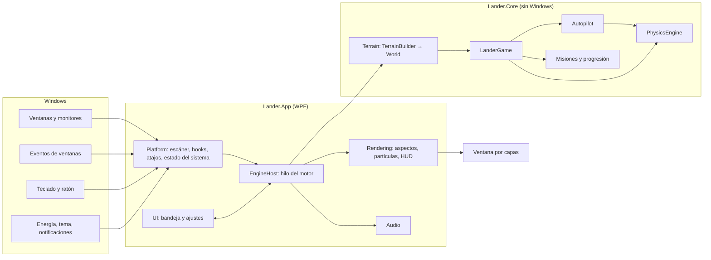
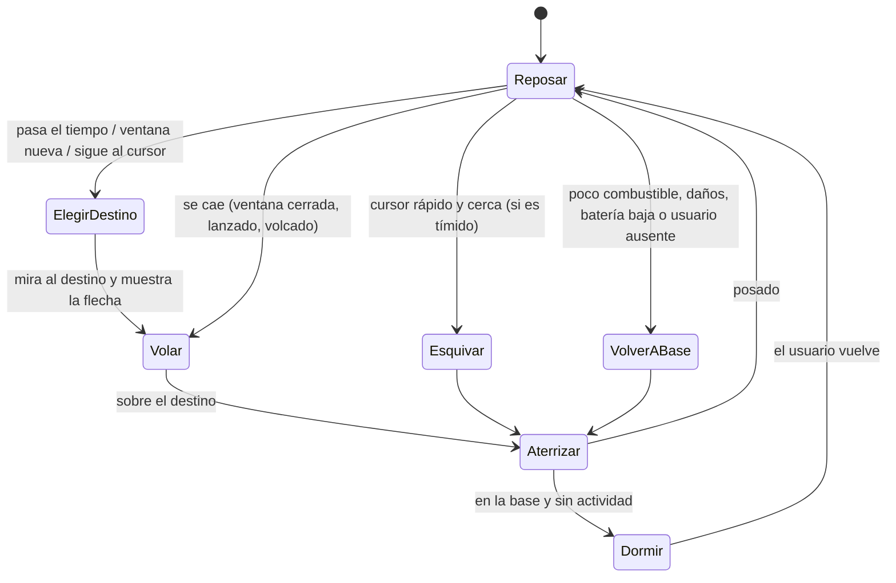

# Arquitectura de Lander

Este documento explica cómo está construido Lander y por qué. El diseño del juego está en
[diseno.md](diseno.md); aquí se cuenta cómo se ha llevado a código y en qué se ha desviado del plan
original.

## Visión general



La regla principal: **todo pasa por la física**. Tanto el jugador como el piloto automático solo
producen un `ThrustInput` (motor, giro, empuje lateral, estabilizador, impulso, patas). Nadie mueve el
lander directamente, así que los dos modos se comportan igual y el piloto automático no puede hacer
trampas.

## Proyectos

| Proyecto | Contenido |
| --- | --- |
| `Lander.Core` | Toda la lógica del juego, en C# puro y sin dependencias de Windows. Se puede probar entera con tests. |
| `Lander.App` | El ejecutable WPF (`Lander.exe`): integración con Windows, motor, render, audio e interfaz. |
| `Lander.Core.Tests` | Tests de xUnit v3 sobre Microsoft.Testing.Platform, incluidas simulaciones de diez minutos de vida autónoma. |

### Lander.Core

- **Terrain**. `TerrainBuilder` convierte monitores y ventanas (en orden Z, de arriba abajo) en un
  `World` inmutable: plataformas de un solo sentido (solo se aterriza desde arriba) y límites (techos,
  suelos de seguridad y paredes con huecos donde hay otro monitor al lado). Recorta las esquinas
  redondeadas de Windows 11, resta las partes de la barra de título tapadas por ventanas de encima y baja
  la plataforma de las ventanas pegadas al borde superior (maximizadas o encajadas con Snap) para que
  quepa el lander, de modo que las ventanas encajadas forman «mesetas» a la misma altura.
- **Physics**. Paso fijo de 60 Hz con integración de Euler semiimplícita. Las magnitudes están definidas
  para un lander de 48 px a 100 % de escala y se multiplican por la escala real (tamaño elegido × DPI
  del monitor), así que la sensación es la misma en cualquier pantalla. Posado sobre una ventana, la
  velocidad de la plataforma se estima a partir de las marcas de tiempo de cada `World` (no de los pasos
  de física), lo que hace la estimación independiente de la frecuencia de escaneo. Con eso se modela el
  agarre de las patas (sigue a la ventana o resbala), el balanceo (terremoto y vuelco) y la separación
  (la ventana cae más deprisa que la gravedad o frena en seco al subir). Los saltos de más de 250 px
  (maximizar, restaurar) se tratan como teletransportes: el lander se queda donde estaba y cae.
- **Autopilot**. Máquina de estados con los siete estados del diseño. El vuelo usa un controlador en
  cascada: posición → velocidad deseada (con perfiles de frenado) → aceleración → inclinación y motor,
  exactamente lo que haría un piloto en modo clásico. La aproximación final es la de un piloto prudente:
  centrarse, estabilizarse en vuelo estacionario y bajar a velocidad de aterrizaje perfecto.
- **Missions** y **Progression**: misiones, puntuación, niveles, desbloqueos y mejoras. Un aterrizaje
  solo puntúa tras un vuelo de verdad (al menos 1,5 s y, si vuelve a la misma plataforma, habiendo
  subido), para que no se puedan granjear puntos tocando y despegando.
- **Settings**: modelo de ajustes y almacenamiento JSON con escritura atómica (archivo temporal y
  reemplazo) y serialización generada en compilación.



### Lander.App

```
Engine/      EngineHost: bucle del motor, sucesos de Windows, efectos y sonidos.
Platform/    Monitores, escáner de ventanas, hooks de eventos, atajos, papelera, escritorios
             virtuales, estado del sistema e inicio con Windows.
Rendering/   Ventana por capas, aspectos (Skins/), partículas, bocadillos, HUD y marcadores.
Audio/       Sonidos sintetizados y mezclador sobre waveOut.
UI/          Icono de bandeja, menú, ventana de ajustes (Fluent) y herramientas de vista previa.
Services/    Ajustes, registro, instancia única y rutas.
Interop/     Declaraciones Win32 con LibraryImport (P/Invoke generado en compilación).
```

## Hilos

| Hilo | Qué hace |
| --- | --- |
| Interfaz (WPF) | Icono de la bandeja, menú, ventana de ajustes y guardado de ajustes y progreso. |
| Motor (STA) | Crea y posee la ventana del lander, los hooks, los atajos y el temporizador; escanea el escritorio, simula, dibuja y decide los sonidos. |
| Audio | Solo existe con el sonido activado: mezcla las voces y alimenta waveOut. |

La interfaz manda órdenes al motor con `EngineHost.Post` (cola concurrente más un evento que lo
despierta) y el motor avisa a la interfaz con `Dispatcher.BeginInvoke`. El progreso viaja como copias
independientes (`PilotProgress.Clone`), nunca compartido.

El bucle del motor espera con `MsgWaitForMultipleObjectsEx` sobre un temporizador de alta resolución y el
evento de órdenes, de modo que atiende mensajes de Windows al instante y no gasta nada entre ciclos. Su
ritmo se adapta:

| Situación | Ciclos por segundo |
| --- | --- |
| Volando, pilotando, partículas o una ventana moviéndose | 60 (30 con ahorro de energía) |
| Cursor cerca o bocadillo visible | 20 |
| Posado y tranquilo | 4 |
| Posado y el usuario lleva más de un minuto sin tocar nada | 2 |

Solo se redibuja cuando cambia algo visible (se compara una firma del estado del fotograma).

## Render: una ventana pequeña que sigue al lander

El diseño proponía una ventana transparente que cubriese todos los monitores. En WPF, una ventana
transparente se compone en software y se copia **entera** en cada fotograma: con 4K o varios monitores
eso son decenas de megabytes por fotograma. En su lugar, el lander vive en una **ventana por capas
pequeña** (unas seis veces su altura) que se mueve con él:

- El fotograma se dibuja con la API de dibujo de WPF (`DrawingVisual`) en un `RenderTargetBitmap`
  reutilizado, se copia a una sección DIB y se presenta con `UpdateLayeredWindow`, que cambia posición e
  imagen **a la vez** (sin tirones al moverse). Un fotograma típico tarda menos de 1 ms.
- Estilos `WS_EX_LAYERED | WS_EX_TOOLWINDOW | WS_EX_TOPMOST | WS_EX_NOACTIVATE`: siempre encima, fuera
  de Alt+Tab y de la barra de tareas, y sin activarse al hacer clic (`WM_MOUSEACTIVATE`).
- Clics: la ventana es transparente al ratón (`WS_EX_TRANSPARENT`) salvo cuando el cursor está sobre el
  cuerpo del lander (comprobación geométrica en cada ciclo), así que ni siquiera el humo bloquea un clic.
- Las partículas viven en coordenadas del mundo y se desvanecen al acercarse al borde de la ventana para
  que no se note el recorte.
- Los marcadores de misión (cristales, balizas) usan sus propias ventanitas transparentes.

Los cinco aspectos son vectoriales y se dibujan en «unidades base» (48 de alto, origen en el centro de
masas); la ventanilla de la cabina hace de ojo y cambia con la expresión. El icono del programa y el de la
bandeja se generan con el mismo código.

## Leer el escritorio

- `WindowScanner` recorre las ventanas con `EnumWindows` (orden Z) y se queda con las visibles, no
  minimizadas, no «cloaked» (así se descartan las de otros escritorios virtuales y las aplicaciones
  suspendidas) y que no son piezas del shell. Usa los límites de DWM
  (`DWMWA_EXTENDED_FRAME_BOUNDS`), sin sombras ni bordes invisibles. Las ventanas de aplicaciones con
  permisos de administrador también se leen sin problema.
- La barra de tareas se deduce del **área de trabajo** de cada monitor: funciona igual centrada o a la
  izquierda, en cualquier borde, con ocultación automática (el suelo pasa a ser el borde inferior) y en
  monitores secundarios. Por eso no hace falta `SHAppBarMessage`.
- `SetWinEventHook` (fuera de proceso, sin inyectar nada) avisa de ventanas que aparecen, se mueven, se
  minimizan o se cierran. Muchas aplicaciones (widgets de Rainmeter, superposiciones) emiten eventos de
  movimiento continuamente sin moverse: solo cuentan los de ventanas que forman terreno y cuyo rectángulo
  ha cambiado de verdad. Además hay un escaneo de seguridad cada dos segundos.
- Mientras se arrastra una ventana se reescanea a 60 Hz; el resto del tiempo, solo cuando algo cambia.

## Integración con Windows

| Función | Cómo |
| --- | --- |
| Atajo global | `RegisterHotKey`; en modo manual se registran también flechas, Espacio y Esc (no se usa un hook de teclado). El estado de las teclas se lee con `GetAsyncKeyState`. |
| Pantalla completa | `SHQueryUserNotificationState` y la ventana en primer plano: si ocupa el monitor del lander, este se muda a otro monitor libre; si no hay ninguno (o es un juego exclusivo o una presentación), aterriza y se esconde. |
| No molestar | `SHQueryUserNotificationState` (horas tranquilas, presentación) y las notificaciones desactivadas en el registro. |
| Inactividad | `GetLastInputInfo`. |
| Batería y ahorro de energía | `GetSystemPowerStatus` y `WM_POWERBROADCAST`. |
| Modo oscuro | Registro (`AppsUseLightTheme`), releído con `WM_SETTINGCHANGE`. |
| Notificaciones | Ventanas del shell `Windows.UI.Core.CoreWindow` cuyo título contiene «notificación». |
| Papelera | `SHChangeNotifyRegister` sobre la papelera y `SHQueryRecycleBin`; la posición del icono se pide a la vista del escritorio (`IShellWindows` → `IShellBrowser` → `IFolderView`). |
| Escritorios virtuales | `IVirtualDesktopManager` mueve las ventanas del lander al escritorio activo. |
| Viento | Raw input del ratón (solo mientras el cursor está cerca del lander) para notar la rueda. |
| Inicio con Windows | Clave `Run` del usuario. |
| DPI | Manifiesto *Per-Monitor V2*: todo el motor trabaja en píxeles físicos. |

## Interfaz

WPF con el tema Fluent de .NET (`ThemeMode = System`), que sigue el modo claro u oscuro de Windows y usa
los colores de Windows 11. Los ajustes reproducen la Configuración de Windows 11 (navegación con
pastilla de acento, tarjetas con icono, interruptores). El icono de la bandeja usa `Shell_NotifyIcon`
directamente (sin WinForms) y se vuelve a añadir si el Explorador se reinicia.

## Rendimiento medido

En un equipo de 16 núcleos con dos monitores (3440×1440 y 1920×1080):

| Situación | CPU |
| --- | --- |
| Posado, usuario ausente | ~0,05 % de un núcleo |
| Dibujo de un fotograma | 0,8 ms |
| Escaneo del escritorio | 0,15 ms |

Con `--demo` y una compilación Debug, el motor registra cada diez segundos sus ciclos, dibujos,
escaneos y eventos por segundo.

## Pruebas

- Tests unitarios de geometría, terreno, física, aterrizajes, puntuación, niveles, misiones y ajustes.
- Simulaciones completas: el piloto automático vuela a ventanas y aterriza perfecto con varias semillas;
  diez minutos de vida autónoma sin un solo accidente; recuperación al desaparecer la ventana; vuelta a
  la base con poco combustible; dormir y despertar; esquivar el cursor; salto con notificaciones; viaje a
  la papelera; lanzarlo con el ratón.
- Durante el desarrollo se usó además una prueba de estrés (40 escritorios aleatorios con dos monitores
  de distinto DPI y ventanas que aparecen, se mueven y desaparecen) para afinar el piloto automático: 0
  accidentes en más de 600 aterrizajes.
- `--preview` y `--preview-settings` permiten revisar todo el arte y la interfaz sin volar.

## Decisiones respecto al documento de diseño

| Diseño | Implementación | Motivo |
| --- | --- | --- |
| .NET 8 | .NET 10 | .NET 8 deja de tener soporte en noviembre de 2026; .NET 10 es la versión LTS actual. |
| Capa transparente a pantalla completa | Ventana pequeña que sigue al lander | Coste por fotograma y ausencia de tirones (ver «Render»). |
| `SHAppBarMessage` para la barra de tareas | Área de trabajo de cada monitor | Cubre todos los casos, también los monitores secundarios. |
| Ocultarse en pantalla completa | Mudarse a otro monitor libre y, si no hay, ocultarse | Con varios monitores, la mascota sigue visible sin molestar. |
| — | Plataformas de un solo sentido y el piloto automático solo se posa en su destino | Evita quedarse atascado sobre una ventana cuando quiere bajar a la base. |

## Limitaciones conocidas

- La detección de notificaciones depende del título de la ventana del shell (funciona en español y en
  inglés) y la de «No molestar» no tiene una API pública completa en Windows 11.
- Solo se publica para x64 (las estructuras de interop asumen alineación de 64 bits).
- Otras ventanas «siempre encima» pueden quedar por encima del lander; cada pocos segundos recupera su
  sitio sin pelearse por él.
